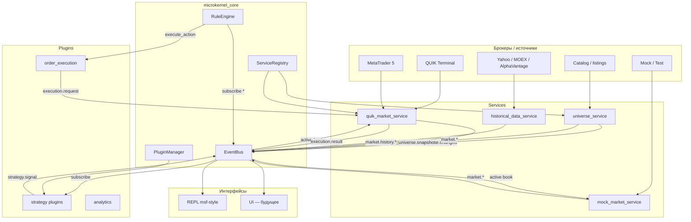
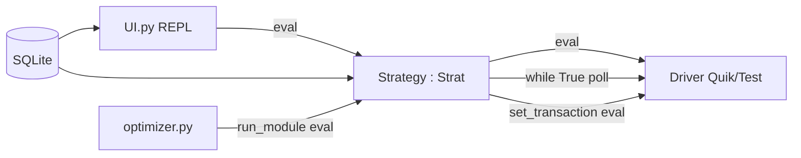

# DATA FLOW

**Статус:** target + legacy (2026-07)  
**Связано:** [[Архитектура — целевая (microkernel)]], [[Event Contract]], [[Продуктовый меморандум trading_bot]], [[Universe selection]]

---

## Целевая схема (microkernel)



**Инвариант:** live `market.candle` / DOM только по **active book** из [[Universe selection]]. Каталог не стримится.

---

## Поток live-сделки (target)

```
0. universe_service.reselect()
     → catalog → candidates → active
     → publish universe.changed { active_keys, added, removed }

1. mock/quik_market_service
     → subscribe universe.changed (или sync active)
     → stream / poll candles ТОЛЬКО для active
     → publish market.candle {ticker, ohlcv, ...}

2. test_strategy plugin
     → subscribed to market.candle
     → updates internal indicators
     → publish strategy.signal {action: BUY, ...}

3. RuleEngine
     → receives strategy.signal
     → runs checks (risk, portfolio, time window)
     → action: order_execution.place_order

4. order_execution plugin
     → builds transaction for QUIK
     → calls service API OR publish execution.request

5. quik_market_service
     → set_transaction(...)
     → publish market.order_update / execution.result

6. REPL / UI
     → optional subscribe for operator feedback
```

**Ключевое:** стратегия **никогда** не вызывает QuikPy напрямую.  
**Ключевое:** market service **никогда** не открывает live на весь catalog.

---

## Поток backtest / optimize

```
historical_data_service
  → batch publish market.history.candle (or replay as market.candle)

strategy plugin
  → same logic as live
  → strategy.signal

BacktestPlugin / RuleEngine dry-run mode
  → metrics.calc_profit on virtual fills
  → optimizer iterates parameter sets
```

---

## Поток запуска (target)

```
host/main.py
  → TradingBotCore()
  → await kernel.boot()
       → ConfigManager.load()
       → EventBus.start()
       → ServiceRegistry.discover(services/)
       → PluginManager.load(plugins/*/manifest.yaml)
       → RuleEngine.load(data/rules/)
       → RuleEngine.subscribe("*")
  → await kernel.start()
       → enabled services.start()
       → plugins.start()  # strategies subscribe in on_initialize
  → REPL.run()  OR  headless
  → await kernel.shutdown()
```

---

## Legacy схема (as-is)



### Legacy поток команды `use strategy test_strategy`

```
UI.use(["strategy", "test_strategy"])
  → current_state = "Strategies/test_strategy.py"
  → current_print = "Strategies/test_strategy"

Strategy.run(...)
  → asyncio loop
  → Strat.candles_stream → eval → Quik().candles_stream(...)
  → set_transaction → eval → Quik().set_transaction(...)
```

---

## Сравнение потоков

| Аспект | Legacy | Target |
|--------|--------|--------|
| Данные | Pull (strategy asks driver) | Push (service publishes) |
| Связность | Strategy knows Driver class | Strategy knows event types only |
| Исполнение | Direct set_transaction | Rule → OrderExecution → Service |
| Dispatch | eval | EventBus + typed handlers |
| Config | SQLite mirror ini | yaml + optional DB |
| Entry | UI.py `__main__` | host/main.py + lifecycle |

---

## REPL в обоих мирах

| Этап | Legacy | Target |
|------|--------|--------|
| Introspection | parse_dir, parse_file | PluginManager + manifest |
| Select module | current_state path | active_plugin_id |
| Run | Functionality.run_module + eval | kernel API / publish command |
| Show options | eval(optimization_parameters) | config schema from manifest |

UX **одинаковый** для оператора; backend меняется.

---

## Ссылки

- [[Universe selection]] — чем торговать; catalog → active
- [[Event Contract]] — payload fields (`universe.*`, `market.*`, …)
- [[REPL — CLI интерфейс]] — команды
- [[TODO/Эпик — Drivers → Services]]
- [[TODO/Эпик — Strategies → Plugins]]
- [[TODO/Эпик — Universe selection]]
